## About

I design and build desktop, web and developer tools with clear interfaces and dependable behavior. Most of my work is native macOS software and Rust desktop apps.

I run [chucamo.org](https://chucamo.org) and maintain [OpenPMCA](https://github.com/OpenPMCA), an open project for Sony PMCA cameras.

## Projects

- **[MacGacha4Life](https://github.com/silent9669/MacGacha4Life)**: native Liquid Glass launcher for Genshin Impact, Honkai: Star Rail and Zenless Zone Zero on Apple Silicon. `Swift`
- **[ani-desk](https://github.com/silent9669/ani-desk)**: cross-platform anime streaming app with a Netflix-style interface and a secure Rust core. `Rust` `Tauri` `TypeScript`
- **[any-watch](https://github.com/silent9669/any-watch)**: private family streaming for desktop, mobile and TV browsers. `Rust`

## Stack

**Languages** 
     

**Native & Desktop** 
 

**Frontend** 
   

**Backend & Database** 
     

**Cloud & DevOps** 
  

**Tooling** 
  

