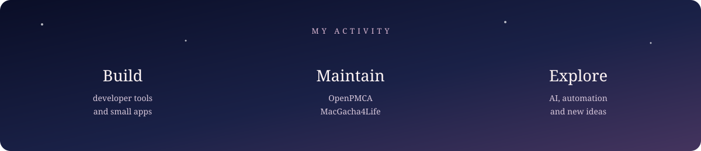

# こんにちは、Dang Phucです。

**Software developer · Open-source maintainer · Ho Chi Minh City, Vietnam**

## About me

I am a software developer from Ho Chi Minh City and the person behind **[chucamo.org](https://chucamo.org)**. I build practical software, developer tools, and small products with a focus on clear interfaces and dependable behavior.

I maintain **[OpenPMCA](https://github.com/OpenPMCA)**, an open-source toolkit for Sony PMCA cameras, and **[MacGacha4Life](https://github.com/silent9669/MacGacha4Life)**, a native macOS app for playing HoYoverse games. I also build **[VJBot](https://github.com/silent9669/VJ_BOT)** for Vietnamese learners studying Japanese, **[ani-desk](https://github.com/silent9669/ani-desk)** for anime libraries, and tools such as **[Codex Atlas](https://github.com/silent9669/codex-atlas)** and **[SkyTrack MCP](https://github.com/silent9669/skytrack-mcp)**.

My work moves between Rust, TypeScript, Tauri, Cloudflare Workers, D1, AI tooling, and automation. I enjoy taking a complicated workflow and making it feel quiet, focused, and easy to use.

## My activity

 

